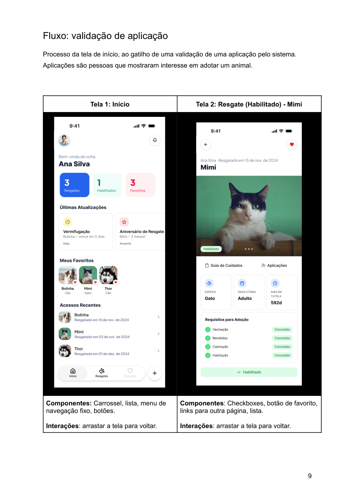

# 02 · Interaction and Interface Design

## Resgate Pet

**Module:** Projeto da Interação Humano Computador e da Interface do Usuário  
**Submitted:** 5 July 2026  
**My work:** Persona and scenario adaptation, interaction modeling, mobile interface design, and prototype documentation.

[Read the Portuguese report](report-pt-BR.pdf) · [View the MoLIC model](molic-interaction-model.pdf) · [Download the Figma file](high-fidelity-prototype.fig) · [Portfolio home](../README.md)

## The problem

Animal rescuers need to coordinate care before finding a suitable adopter. The design explores how an application can support both occasional and experienced rescuers.

It builds on the [user research from Module 01](../01-user-research/README.md). The personas and scenarios were adapted for this design exercise.

## Design goals

The interaction model covers two goals:

1. Support animal stabilization and care through food, medical attention, vaccination, and neutering.
2. Support responsible adoption after the animal meets the necessary health requirements.

## Approach

**MoLIC** means *Modeling Language for Interaction as Conversation*. The model describes conversations between the user and the system.

The diagram maps the two goals, alternative paths, supporting conversations, processing states, and recovery from interaction problems.

The mobile prototype focuses on reviewing adoption applications. It shows the path from a rescue record to applicant validation and contact.

## Design decisions

| Decision | Purpose |
| --- | --- |
| Care guidance and a care checklist | Help less experienced rescuers understand the next steps. |
| Favorites and recent access | Support repeated work by experienced users. |
| Visible validation progress and results | Explain system processing and its outcome. |
| Applicant information and contact actions | Support the rescuer's decision and follow-up. |

The application validation and scoring screens illustrate a proposed interaction. The coursework does not establish the accuracy of an automated screening system.

## Artifacts

- [Submitted report](report-pt-BR.pdf): goals, personas, scenarios, interaction model, screen flows, and component descriptions.
- [MoLIC interaction model](molic-interaction-model.pdf): full diagram as a separate PDF.
- [High-fidelity prototype](high-fidelity-prototype.fig): editable Figma file.
- [Figma design and prototype](https://www.figma.com/design/ICBrdDhraMPF59R3xWuiTm/PUCRio---Sprint--Projeto-IHC-e-UI---0726-MVP---Sistema-de-Ger%C3%AAncia-de-Resgates-de-Animais?node-id=5498-5066): original design link from the report; access depends on Figma sharing settings.
- [Figma interaction model](https://www.figma.com/design/ICBrdDhraMPF59R3xWuiTm/PUCRio---Sprint--Projeto-IHC-e-UI---0726-MVP---Sistema-de-Ger%C3%AAncia-de-Resgates-de-Animais?node-id=5515-5377): original model link from the report.

## Scope

This module delivers an interaction model and a prototype. It does not include evidence of a usability test of Resgate Pet.

The [Module 03 evaluation](../03-usability-evaluation/README.md) examines Vakinha, a separate existing service.
