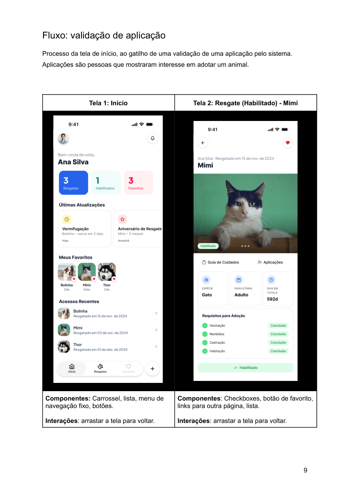

# HCI + UX Specialization

Portfolio of three MVP projects completed during my postgraduate specialization in **Human–Computer Interaction and User Experience (UX)** at **PUC-Rio**.

**Lucas H. Rinaldi · 3 February – 5 October 2026 · Online · 360 hours**

The projects cover user research, interaction design, interface prototyping, and usability evaluation. English summaries introduce the work. The submitted reports and design artifacts are in Brazilian Portuguese.

## Explore the projects

| Module | Project | Methods and deliverables | Read the work |
| --- | --- | --- | --- |
| 01 · User Research | Animal rescue and community support | Semi-structured interviews, pilot, evidence synthesis, personas, problem scenarios | [Case summary](01-user-research/README.md) · [Portuguese report](01-user-research/report-pt-BR-public.pdf) |
| 02 · Interaction and Interface Design | Resgate Pet | MoLIC interaction model, mobile interface, high-fidelity Figma prototype | [Case summary](02-interaction-design/README.md) · [Portuguese report](02-interaction-design/report-pt-BR.pdf) |
| 03 · Usability Evaluation | Vakinha | Nielsen heuristic evaluation, severity ratings, moderated usability tests, recommendations | [Case summary](03-usability-evaluation/README.md) · [Portuguese report](03-usability-evaluation/report-pt-BR-public.pdf) |

## From research to interaction design

The first project investigated how animal rescuers coordinate help and manage uncertain information. Its findings informed **Resgate Pet**, the interaction design project in Module 02.

The third project evaluated **Vakinha**, an existing crowdfunding service. It is a separate evaluation case. It does not validate the Resgate Pet prototype.

*Screens from the submitted Resgate Pet report. Open the case summary for the interaction model and Figma prototype.*

## What this work demonstrates

- Planning and conducting exploratory user research.
- Connecting interview evidence to personas and problem scenarios.
- Modeling interaction as a conversation with MoLIC.
- Designing mobile flows, system feedback, and application states.
- Comparing inspection findings with observed usability problems.
- Turning usability findings into prioritized recommendations.

## About the materials

The English summaries were prepared for this portfolio from the submitted coursework. The original reports remain in Portuguese.

The public copies of the research and evaluation reports exclude private appendices. Recordings, full interview transcripts, signed consent forms, and raw questionnaire responses are not included. See [Publication notes](PUBLICATION-NOTES.md) for the exact changes.

The design report, MoLIC model, and Figma file reproduce the submitted design artifacts. These are academic projects. The recommendations do not represent measured product improvements or an affiliation with Vakinha.

**Author:** [Lucas H. Rinaldi](https://github.com/lhrnd0)
